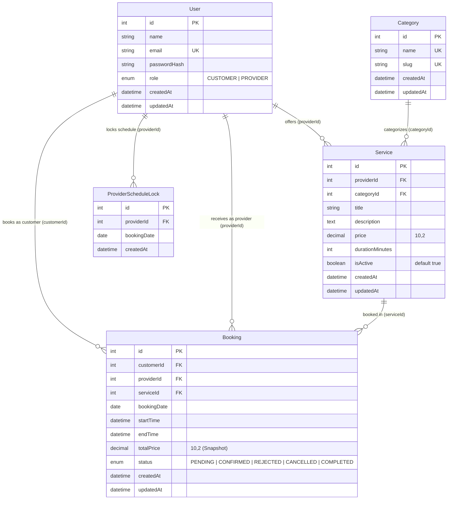

# Database Schema Documentation

This document provides complete documentation for the relational database schema implemented in MySQL using Prisma ORM for the **Service Booking Platform**.

---

## 1. Entity-Relationship Overview

---

## 2. Table Definitions

### 2.1 `users`
Represents all system actors with role-based access control.

| Column | Type | Nullable | Default | Description |
|---|---|---|---|---|
| `id` | `INT` | No | `AUTO_INCREMENT` | Primary Key |
| `name` | `VARCHAR(191)` | No | None | Full legal or display name |
| `email` | `VARCHAR(191)` | No | None | Unique login email address |
| `passwordHash` | `VARCHAR(191)` | No | None | Bcrypt password hash (cost factor 10) |
| `role` | `ENUM('CUSTOMER','PROVIDER')` | No | `'CUSTOMER'` | System role governing endpoint authorization |
| `createdAt` | `DATETIME(3)` | No | `CURRENT_TIMESTAMP(3)` | Record creation timestamp |
| `updatedAt` | `DATETIME(3)` | No | `CURRENT_TIMESTAMP(3)` | Record last update timestamp |

**Indexes & Constraints**:
- `PRIMARY KEY (id)`
- `UNIQUE KEY uk_users_email (email)`

---

### 2.2 `categories`
Standardized industry categories for service classification and marketplace filtering.

| Column | Type | Nullable | Default | Description |
|---|---|---|---|---|
| `id` | `INT` | No | `AUTO_INCREMENT` | Primary Key |
| `name` | `VARCHAR(191)` | No | None | Unique display name (e.g. "Home Cleaning") |
| `slug` | `VARCHAR(191)` | No | None | URL-safe slug (e.g. "home-cleaning") |
| `createdAt` | `DATETIME(3)` | No | `CURRENT_TIMESTAMP(3)` | Creation timestamp |
| `updatedAt` | `DATETIME(3)` | No | `CURRENT_TIMESTAMP(3)` | Update timestamp |

**Indexes & Constraints**:
- `PRIMARY KEY (id)`
- `UNIQUE KEY uk_categories_name (name)`
- `UNIQUE KEY uk_categories_slug (slug)`

---

### 2.3 `services`
Service offerings published by providers.

| Column | Type | Nullable | Default | Description |
|---|---|---|---|---|
| `id` | `INT` | No | `AUTO_INCREMENT` | Primary Key |
| `providerId` | `INT` | No | None | Foreign Key referencing `users(id)` |
| `categoryId` | `INT` | No | None | Foreign Key referencing `categories(id)` |
| `title` | `VARCHAR(191)` | No | None | Descriptive service title |
| `description` | `TEXT` | No | None | In-depth description of the service |
| `price` | `DECIMAL(10,2)` | No | None | Current unit price in currency |
| `durationMinutes` | `INT` | No | None | Appointment duration in minutes (e.g. 60, 90, 120) |
| `isActive` | `BOOLEAN` | No | `true` | Active status flag; soft deletion sets this to `false` |
| `createdAt` | `DATETIME(3)` | No | `CURRENT_TIMESTAMP(3)` | Creation timestamp |
| `updatedAt` | `DATETIME(3)` | No | `CURRENT_TIMESTAMP(3)` | Update timestamp |

**Indexes & Constraints**:
- `PRIMARY KEY (id)`
- `FOREIGN KEY (providerId) REFERENCES users(id) ON DELETE CASCADE`
- `FOREIGN KEY (categoryId) REFERENCES categories(id) ON DELETE RESTRICT`
- `INDEX idx_services_active_category (isActive, categoryId)` — Optimizes marketplace catalog filtering.
- `INDEX idx_services_active_price (isActive, price)` — Optimizes min/max price range filtering.
- `INDEX idx_services_active_created (isActive, createdAt)` — Optimizes newest/oldest catalog pagination.
- `INDEX idx_services_provider_created (providerId, createdAt)` — Optimizes provider's private service list.
- `INDEX idx_services_category (categoryId)` — Foreign key lookup optimization.

---

### 2.4 `bookings`
Customer appointments scheduled with service providers.

| Column | Type | Nullable | Default | Description |
|---|---|---|---|---|
| `id` | `INT` | No | `AUTO_INCREMENT` | Primary Key |
| `customerId` | `INT` | No | None | Foreign Key referencing `users(id)` (Customer) |
| `providerId` | `INT` | No | None | Foreign Key referencing `users(id)` (Provider) |
| `serviceId` | `INT` | No | None | Foreign Key referencing `services(id)` |
| `bookingDate` | `DATE` | No | None | Calendar date of appointment (`YYYY-MM-DD`) |
| `startTime` | `DATETIME(3)` | No | None | Slot start time |
| `endTime` | `DATETIME(3)` | No | None | Slot end time (`startTime + durationMinutes`) |
| `totalPrice` | `DECIMAL(10,2)` | No | None | **Price Snapshot**: The exact price at booking time |
| `status` | `ENUM('PENDING','CONFIRMED','REJECTED','CANCELLED','COMPLETED')` | No | `'PENDING'` | Current status in lifecycle state machine |
| `createdAt` | `DATETIME(3)` | No | `CURRENT_TIMESTAMP(3)` | Booking creation timestamp |
| `updatedAt` | `DATETIME(3)` | No | `CURRENT_TIMESTAMP(3)` | State transition timestamp |

**Indexes & Constraints**:
- `PRIMARY KEY (id)`
- `FOREIGN KEY (customerId) REFERENCES users(id) ON DELETE RESTRICT`
- `FOREIGN KEY (providerId) REFERENCES users(id) ON DELETE RESTRICT`
- `FOREIGN KEY (serviceId) REFERENCES services(id) ON DELETE RESTRICT`
- `INDEX idx_bookings_provider_date_status (providerId, bookingDate, status)` — Optimizes concurrency overlap detection and slot availability queries.
- `INDEX idx_bookings_customer_created (customerId, createdAt)` — Optimizes customer booking history pagination.
- `INDEX idx_bookings_provider_created (providerId, createdAt)` — Optimizes provider booking request queue.
- `INDEX idx_bookings_service (serviceId)` — Foreign key index.
- `INDEX idx_bookings_time_range (startTime, endTime)` — Range lookups.
- `INDEX idx_bookings_status (status)` — Status filtering.

---

### 2.5 `provider_schedule_locks`
Helper lock entity for fine-grained per-date schedule serialization.

| Column | Type | Nullable | Default | Description |
|---|---|---|---|---|
| `id` | `INT` | No | `AUTO_INCREMENT` | Primary Key |
| `providerId` | `INT` | No | None | Foreign Key referencing `users(id)` |
| `bookingDate` | `DATE` | No | None | Date of provider schedule lock |
| `createdAt` | `DATETIME(3)` | No | `CURRENT_TIMESTAMP(3)` | Lock creation timestamp |

**Indexes & Constraints**:
- `PRIMARY KEY (id)`
- `UNIQUE KEY uk_provider_schedule_locks (providerId, bookingDate)`
- `FOREIGN KEY (providerId) REFERENCES users(id) ON DELETE CASCADE`

---

## 3. Key Design Decisions

### 3.1 Financial Integrity via Price Snapshotting
When a booking is created, the system copies `service.price` into `booking.totalPrice`. If the provider subsequently modifies their service price (e.g. from ₹999 to ₹1,499), all historical and pending bookings retain the original snapshot price, ensuring financial audit compliance and zero unexpected invoice adjustments.

### 3.2 Soft-Deactivation Strategy
When a provider deletes a service via `DELETE /api/services/:id`, the backend executes an `UPDATE services SET isActive = false`. This removes the service from public catalog search while preserving referential integrity and historical records for all past bookings.

### 3.3 Foreign Key Protection Rules
- `User -> Service`: `ON DELETE CASCADE` (deleting a provider cascades to unbooked service definitions).
- `User/Service -> Booking`: `ON DELETE RESTRICT` (prevents deleting active users or services that have historical booking records).
